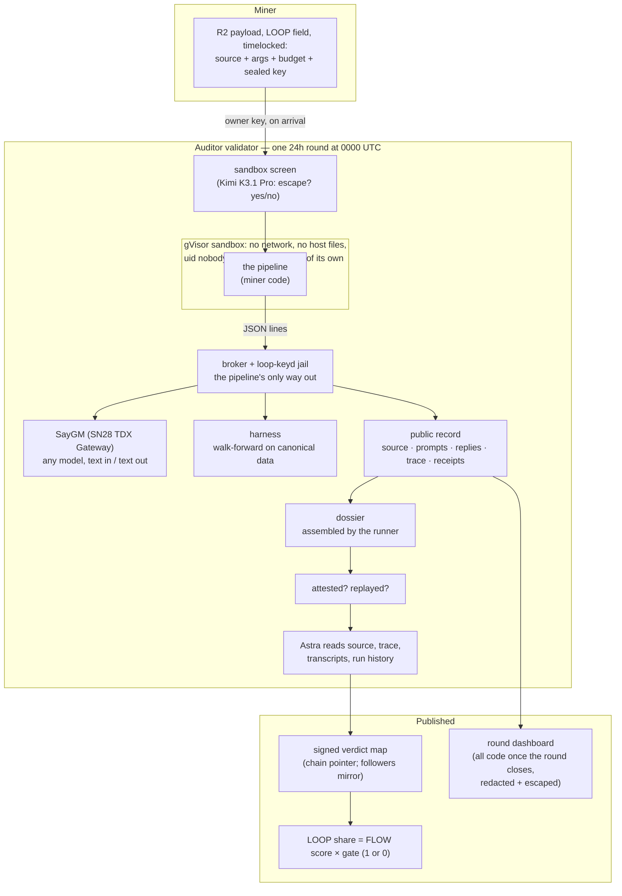

# LOOP — the MANTIS autoresearch challenge

One thing is being bought here: **the autoresearch frontier**.  A
miner's edge is the autoresearch pipeline it designs — a program that
spends inference on models and experiments to find a trading model.
Miners write pipelines, **publish their source**, provide SayGM (SN28)
inference (their own `gm_live_...` <= $25 burner key; OpenRouter is
refused), and the auditor validator runs them sealed in **24-hour
rounds**: a submission rides the miner's ordinary R2 payload, the
auditor reads it on arrival with the owner key, a new round opens at
0000 UTC over everything received in the preceding day, and before any
miner code executes, a screening judge (`kimi-k3.1-pro-tee`, fallback
`qwen3.5-397b-a17b-tee`, `qwen3.8-27b` — `LOOP_SCREEN_MODELS`) answers
one yes/no: *does this code try to escape its sandbox?*  Yes = it never
runs.  When a round closes, everything its runs did goes public — the
source, every prompt and reply, every experiment, the model each ended
on, all of it on the round dashboard — so the field is open: read the
pipeline that is winning, fork it, beat it in the next round.  The
best autoresearch library wins, and stays public.  **There is no
gateway in production**: submissions come off the chain, evidence is
read off the runner's own ledger, verdicts leave through the signed
feed and its on-chain pointer, and the dashboard is a rendered file.

Miners are assumed to be adversaries.  The design goal is that nothing
a miner *says* is ever evidence; the only things that count are what
the gateway did on the miner's behalf and what anyone can recompute.

```
credit(hk) = Σ frontier advances by hk × 0.5^(age / 14d), expiring at 4 half-lives
LOOP share(hk) = credit(hk) / Σ credits × audit_multiplier(hk)
                                          └ 1 or 0: smuggling gate ┘
no live credit anywhere -> the whole slice burns
```

Pay is **progress on historical performance** (Refinery-style, SN125):
the measuring stick is the FLOW EWMA score a model's trades accumulate
as they resolve — which no one can fake because the future has not
happened yet — and the split is by **frontier credits**.  Walking the
shared history hour by hour, whoever pushes the best audited score ever
seen higher books a credit equal to the advance; credits halve every 14
days (`LOOP_CREDIT_HALF_LIFE_H`) and expire after four half-lives; the
full slice pays pro rata by live credit, and with no live credit —
stagnation — it burns absolutely.  Matching the leader pays nothing;
beating it pays the improvement, linearly, so splitting an advance
across hotkeys earns exactly the advance.  Everything is a pure
function of the shared datalog plus the mirrored audit map: no new
consensus state, and a gated hotkey can neither book credit nor raise
the bar.  The validator's job is deliberately
small: deterministic checks (the run was sealed, the numbers replay),
then a frontier model (Astra) answering one question — *was anything
smuggled in?*  Not smuggled = 1, smuggled = 0.  Research **quality is
not judged in this version**: the market judges it, through the trades.
The ruleset is a v0 and will be developed in the open — see the
announcement note below.

Allocation: **5% of the pool** (`LOOP_TARGET_FRACTION` in
`config.py`), raised by hand as the field proves out.

---

## How a run works



1. **Submit.**  Put the submission in your payload's `LOOP` field
   (`submission.build_loop_field`): source, JSON arguments, budget, and
   your SayGM (`gm_live_...`) key sealed to LOOP's signed rotating round
   key (`<LOOP_PUBLIC_URL>/seal_keys.json`) with the submission's own
   hash as associated data.  The payload is already encrypted and already
   authenticated as your hotkey's.  The auditor opens it through its
   owner wrap as soon as it fetches it (`RoundRunner.take_payloads`,
   `submission.open_payload`) and keeps only the submission, in its
   private ledger, stamped with when it was first read; at 0000 UTC the
   round takes each hotkey's newest submission first read in the last
   24 hours.  Each (hotkey, sha256-of-submission) runs once, ever: the
   copy the datalog decrypts when the payload matures a week later
   (`PAYLOAD_MATURITY_BLOCKS`) is the same submission, and is skipped.
   The source goes public when its round closes — sooner only if the
   miner's own timelock opens sooner, so LOOP payloads take the
   week-long lock (`TLOCK_PROD_SUGGESTED_LOCK_SECONDS`).
2. **Screen.**  Before the code executes, `rounds.screen_source` asks a
   strong open-weights judge the one question above, about the source
   and its args read together (`rounds.screen_text`: code can ride in
   on args).  Executing code it cannot read (encoded, compressed or
   encrypted) counts as yes.  "Yes" blocks the run; no screen model
   answering blocks it too (fail closed, recorded `unscreened`).
3. **Sealed execution.**  The runner executes the pipeline in a sandbox
   (`sealed.Sandbox`): gVisor (`runsc`), whose kernel runs in user
   space, so the pipeline's system calls never reach the host's — a
   root holding only `/usr` and the pipeline's own directory, both
   read-only, and a small tmpfs; uid nobody, no capabilities, rlimits.
   It has no network, sees none of the host, and has exactly one
   connection: JSON lines to the **broker**.  It runs in a fixed share
   of the machine, the same for every run (below).
4. **The broker does the work** (`sealed.Broker`).  Through
   `loop_sdk` the pipeline can:

   | call | what the gateway does |
   |---|---|
   | `loop.data()` | returns the research window of the canonical dataset: the hourly BTC target plus ~10 years of daily auxiliary series (BTC, five forex majors, ETH, gold), every series cut at the same moment — **the most recent 480 target bars are held back** |
   | `loop.models()` | lists every SayGM (SN28) text model with context length and pricing |
   | `loop.llm(model, messages, step=...)` | calls any SayGM model — one, several, a different one per step — meters it, stores the whole request and reply as public blobs |
   | `loop.propose(spec, refines=..., source=reply)` | validates the model spec and registers a candidate |
   | `loop.experiment(candidate)` | runs **the protocol's harness** on the candidate and returns its walk-forward metrics |
   | `loop.critique(candidate, verdict, notes, source=reply)` | records the pipeline's own verdict on it |
   | `loop.promote(candidate)` / `loop.prune(candidate)` | records what the pipeline decided |
   | `loop.finish(narrative, hyperparameter_rationale)` | the pipeline's account of itself |
   | `loop.checkpoint(state)` / `loop.restore()` | the pipeline's own memory across a pause: one JSON slot, written only by the sealed pipeline itself |

   **Every event in the trace is written by the broker** from what it
   did or checked.  There is no call that reports a result.
5. **Close.**  When the pipeline exits, the runner scores the promoted
   model once on the held-back bars, computes the trade the model takes
   at the last bar, charges the pipeline's running time, and assembles
   the **dossier**.  A pipeline that crashes, times out or speaks
   out of turn gets no dossier (and still pays for what it used).
6. **Audit and publish.**  The panel audits the dossier against
   evidence read straight off the ledger (`audit.local_evidence` — no
   HTTP anywhere), the signed verdict map goes out, and the round
   journal (`logs/loop/round-*.jsonl`) plus the dashboard record every
   entry's fate: `refused`, `blocked`, `unscreened`, `failed` or
   `audited` with its multiplier.  With the round closed, the dashboard
   now shows every entry's code and research; while it ran, it showed
   statuses only.  The miner's whole part was step 1.

**Stopping the runner pauses runs instead of killing them.**  On
shutdown every live pipeline is told to pause — its next SDK call
raises `loop.Paused`, `loop.checkpoint` still works — given
`LOOP_PAUSE_GRACE_SECONDS` (default 20) to save and exit, and parked as
`paused`: the trace, receipts, budget and checkpoint are already in the
ledger, so nothing is lost but the process.  On the next start the
round picks its entries back up: a credit-funded run resumes by itself,
and a BYOK run's key is opened fresh from the sealed blob still sitting
in the submission (the plaintext was never stored), so resumption is
automatic for everyone.  A run paused longer than
`LOOP_RESUME_WINDOW_SECONDS` (default 3 days) fails.  A resumed run
continues the same trace with the same candidate ids under the same
budget, and the wall clock picks up where it stopped — a `run.paused` /
`run.resumed` pair in the trace marks the seam.  (The dev gateway also
exposes signed `resume`/`cancel` routes for interactive work.)
Pipelines opt in with one habit: call `loop.restore()` first and
`loop.checkpoint(state)` every iteration (see
`pipelines/reference.py`), and a pause costs at most one iteration of
work.

### Every run on equal terms

A round can hold 256 entries (one per UID), all run on the auditor's
one machine (`slots.py`).  Every run gets the same fixed share of it
(`slots.RunShape`): a core no other run is on, 4 GB of memory (its
64 MB of scratch space and its experiments included), 512 processes.
Each run has a cgroup of its own that holds its sandbox and the
harness experiments it asks for; a run that outgrows its memory is
killed alone (`ran out of memory`), and nothing it starts outlives
it.  As many runs go at a time as fit beside the 2 cores and 8 GB
kept for the validator itself (20 on a 22-core, 118 GB host); the
rest wait in line.

When a round opens the auditor screens its entries, then fixes its
**plan** and records it in the ledger and the journal, so a restart
keeps it: the number of entries that passed (what is turned away
shortens nobody's clock), how many run at a time, one dataset
snapshot that every
entry researches whenever its turn comes, and one wall clock for
every run,

```
run clock = min(12 h, 20 h / ceil(entries / runs at a time))
```

so the whole round fits in 20 hours however many enter (200 entries
at 20 at a time: 2 hours each; 256: 1 hour 32 minutes), leaving the rest of
the day for the audits, which start as runs finish.  The round's page
states its terms; a pipeline reads what its clock has left from
`loop.budget()["seconds_left"]`.  `python -m autoresearch.slots`
prints what a host holds and the schedule it would run.

### The dataset

One content-addressed JSON object (`data.build_dataset`), fetched when
the run is opened and named in the dossier by its sha256:

| series | source | span |
|---|---|---|
| `BTC_1h` (**target**) | Binance BTCUSDT | ~2.3 years hourly — the series the model trades and all labels come from |
| `BTC_1d` | Coinbase BTC-USD | ~10 years |
| `EURUSD_1d` `USDJPY_1d` `GBPUSD_1d` `AUDUSD_1d` `USDCHF_1d` | ECB reference rates | ~10 years |
| `ETH_1d` | Binance ETHUSDT | since 2017 |
| `XAU_1d` | Binance PAXGUSDT (tokenised gold) | since 2020 |

Every bar carries its **close time**, and a feature on an auxiliary
series reads, at each target bar, the last bar that had *closed* by the
target bar's close — cross-market features are possible, lookahead is
not.  ECB rates are stamped two hours after publication to stay on the
late side.  The research window cuts **every** series at the holdout
cutoff, so the held-back bars cannot leak in through a daily series.

### A model is a spec, not code

```json
{"feature": {"transform": "rsi", "lookback_hours": 168, "series": "EURUSD_1d"},
 "hyperparams": {"C": 1.0, "threshold": 0.52, "horizon_h": 36, "regime": 1,
                 "f": 0.05, "sl": 0.03, "tp1": 0.04, "tp2": 0.08}}
```

A candidate is one causal feature — a transform (`harness.TRANSFORMS`),
a lookback of 8–720 h, and the series it reads (default: the target) —
plus the hyperparameters of the bracket it trades.  The harness
(`harness.py`, published at `GET /v1/harness`, identified by its
sha256) is the only code that turns a spec into a number or a trade.
That is what makes results unforgeable rather than merely signed:

* a miner cannot report metrics the model did not earn — no miner code
  computes metrics;
* lookahead is impossible — the feature and the walk-forward split are
  the harness's, and the pipeline never holds the last 480 bars;
* a long-horizon view cannot be declared as a feature — the vocabulary
  and the 720 h cap are enforced when the spec is proposed.

The cost is expressiveness: today's model space is small (five
transforms × lookback × nine series × bracket).  Widening it means
adding vocabulary to the harness, not letting miners run their own
model code.

The harness goes long when the model's probability of an up-move beats
the training base rate by `threshold − 0.5`, short when it trails it by
as much, and otherwise stays out.  (The first harness compared the
probability to the threshold directly, so in a market that had drifted
up every feature went long and every candidate got the same numbers.
Metrics include `long_frac` and `always_long_avg_r`, so drift is
visible as drift, and `unfiltered_avg_r` / `unfiltered_t` — the same
fitted model trading its signal's sign on every bar, the naked factor —
so beta is visible as beta: a model whose thresholded trades do not
clearly beat its own unfiltered baseline is factor exposure, not a
conditional system, and the ruleset (R1) caps it accordingly.)

Every evaluation also carries a **quantile receipt**: `quantile_r` is
the mean forward return by feature band — the feature's distribution
partitioned around its 1st/10th/50th/90th/99th percentiles — `monotone`
is ±1 when that chain is strictly ordered, and `monotone_robust` means
the direction survives the lookback pulled a quarter either way (an
EMA-style "less specific hyperparameters" check).  A fitted threshold
can get lucky; a strictly ordered response curve that replicates under
perturbation almost never happens by chance (noise earns `monotone 0`),
so it is the clearest promote evidence a loop can hold.  The shipped
pipelines treat it as such: it lowers their significance bar and earns
an evolution fitness bonus.

### What a miner controls, and what it cannot

| A miner chooses | A miner cannot |
|---|---|
| the pipeline: prompts, any OpenRouter models in any combination (`loop.models()` lists them with prices), how many candidates, how verdicts are reached, when to stop, how the budget is split | write a trace event, a metric, a receipt or a dossier |
| the budget, and when to run | see the held-back bars from inside a run |
| which finished run's dossier to publish | publish a dossier the gateway does not hold, or another hotkey's |
| the words: names, rationales, critic notes, the narrative | reach the network, the host, or another run |
| | have a model fetch something for it (web plugins, `:online` models, image/file URLs are refused) |

### The credit lifecycle

**The short version: miners provide SayGM (SN28) inference (no OpenRouter).**
Every submission carries the miner's own SayGM (`gm_live_...` <= $25
burner) key, sealed to LOOP's rotating round key: `loop-keyd` verifies
the `<= $25` balance ceiling before starting the run, executes all model
calls in an isolated non-dumpable daemon (`validator.py` never holds the
plaintext key), strips `key_sealed` from `datalog.db` and closed
`loop_inbox` rows, and shreds expired round private keys after the
resume window.

1. **Grant** — a run with a vetted key is granted its own budget when it
   is submitted (memo "miner-provided inference").  A run without one
   needs a balance, which only the owner grants
   (`python -m autoresearch.credits grant <hotkey> <credits>`).
2. **Budget** — each run has a **miner-set budget**, a hard cap enforced
   both in `CreditLedger` and independently inside `loop-keyd`.
3. **Spend** — model calls at SayGM's settled USD cost accounting
   (1 credit = 1 USD), experiments per metered second (RunPod when
   configured, the local executor otherwise), and the pipeline's own
   running time per second.  When the budget is gone the next paid call
   raises `BudgetExhausted` and the run closes in order.
4. **Receipts** — every debit is an HMAC-signed `UsageReceipt` saying
   what step it paid for.  Public, and referenced by digest in the
   dossier.

---

## The validator audit

`audit.audit_cycle` — for each miner, fetch the published dossier, then:

| Stage | Cost | A dossier fails if |
|---|---|---|
| **Attested** (`attestation_checks`) | free | it is not exactly the dossier the gateway assembled for a sealed run of this hotkey that ran to its end; the pipeline source or dataset is not published; the trace or receipts are not the ones it was built from; a receipt's HMAC is wrong; it was scored by another harness |
| **Searched** (`model_checks`) | free | the run made fewer than 3 experiments or promoted nothing; the dossier's model is not the one the run promoted; no walk-forward + held-out validation |
| **Replayed** (`replay`) | ~1 s | the validator, running the harness itself on the run's dataset (fetched by hash), does not get the dossier's walk-forward metrics, held-out result and trade |
| **Judged** (`AuditorPanel`) | one frontier call, cached | the judge answers "smuggled" — see below |

Any failure in the first three is multiplier 0 and no model call is
spent.

**The judge is the frontier model** (`openai/gpt-6-astra`;
`LOOP_AUDIT_JUDGES`).  It is reading source code written by someone
paid to fool it, so it is not the place to save money.  It is shown
(`audit.judge_input`, deterministic, so every validator's judge reads
the same thing):

* the dossier, including the held-out result;
* **the pipeline's source** and arguments;
* the whole trace;
* the full exchanges — prompts and replies — with the models that
  proposed and criticised the promoted candidate;
* this hotkey's run history: how many runs, how many of this pipeline.

The judge answers **one question — was anything smuggled in?** — true
or false, against the ruleset published verbatim in `audit.RULESET`
(v0).  Smuggling is any way the answer or the verdict arrives from
outside the run's own sealed search: a carried-in answer (hard-coded
models, prompts that steer to a predetermined candidate, a search space
of one, rerun-elsewhere-until-it-passed), a long-horizon directional
conviction dressed as a short-horizon model, or text addressed to the
audit itself.  The judge is told that every piece of prose it sees is
the miner's and none of it is addressed to it; that a pipeline's own
in-loop critic is the loop working as designed; and — explicitly — that
**honest and naive passes**: it must not punish research for being
unprofitable or unsophisticated, because quality is paid by the market,
not by the audit.

**The announcement should say this out loud.**  The ruleset is a v0 on
purpose.  It does not judge whether the research is any good — a naive
model honestly found gets multiplier 1 and then earns whatever its
trades earn.  And it will be **iterated, not debated**: miners WILL
find ways to game it; each way that emerges gets an amendment and a
version bump, fast, without a comment period.  A verdict is always
against the published version of the moment, the ruleset ships verbatim
in the judge prompt and in this repo, and its git history is the record
of what was tried against it.

Rules that keep the verdict from being gamed or flapping:

* **Cached by dossier hash.**  One frontier call per dossier, ever;
  taking a dossier down and putting it back does not buy a second
  opinion.
* **What pays is what is published now.**  The multiplier is the
  verdict on the dossier at `<hotkey>.research` today — not the best
  verdict the hotkey ever had.
* **No verdict, no pay.**  A new dossier the judge gives no usable
  verdict on earns 0 until it is judged; it does not inherit the
  previous dossier's verdict (otherwise a dossier built to choke the
  judge
  would keep the old pay).  It is retried, at most hourly.
* **Infrastructure failures decide nothing.**  If the miner's bucket or
  the gateway cannot be reached, the hotkey keeps what it had.
* **Binary, temperature 0, fixed seed.**  A yes/no is also the verdict
  format hardest to drift on.  More slugs in `LOOP_AUDIT_JUDGES` gives
  a majority vote.

### Weight consensus across validators

An LLM verdict is the one input to a LOOP weight that other validators
cannot recompute bit-for-bit (the FLOW trade leg is deterministic from
the shared datalog).  So there is **one judge** — the auditor, which is
always the validator holding **UID 0** (the subnet owner's) — and it
*asserts* its verdicts instead of hoping everyone's judge agrees:

1. After every round the auditor exports its verdict map — every
   publishing hotkey, the dossier hash it published, the multiplier —
   **signed sr25519 by the auditor's hotkey**
   (`audit.export_verdicts`), writes it into the dashboard site as
   `verdicts/<digest>.json`, and **commits a pointer on chain** with
   its hotkey (`audit.publish_to_site`):
   `loopfeed2 <LOOP_PUBLIC_URL>/verdicts/<digest>.json`, the file
   named by the first 128 bits of the payload's digest — the same
   commitment mechanism miners use for their payload URLs.  The chain
   takes at most 128 bytes, so `config.LOOP_PUBLIC_URL` must be short
   (at most 71 characters; the auditor refuses to start rounds on one
   that cannot fit); a commit that fails is retried every five minutes
   for half an hour.
2. Every validator — the auditor included — pays on that published
   map.  **There is nothing to configure**: each validator reads which
   hotkey holds UID 0 off the metagraph (`scoring.uid0_hotkey`,
   re-read hourly), reads that hotkey's commitment, fetches whatever
   URL it names (`audit.ChainFeed`, re-read every five minutes),
   verifies the sr25519 signature **and**
   that the payload's digest matches the committed one, and applies the
   multipliers.  No judge runs, no OpenRouter key is needed, and the
   LOOP weight vector comes out identical everywhere: the auditor reads
   its own map back from the chain rather than its local cache, so it
   never pays ahead of the validators following it.
3. Whoever serves the bytes is untrusted.  A forged payload fails the
   signature; a stale mirror replaying an older — even correctly
   signed — payload fails the digest pinned on chain; a follower never
   adopts a payload older than the one it holds.  Consensus beats
   liveness on purpose: if the chain or the feed is unreachable,
   followers keep applying the **last verified** map (cached on disk,
   `.storage/loop_verdicts.json`) rather than diverging to defaults.
   (`LOOP_AUDITOR_HOTKEY`, `LOOP_AUDIT_FEED_URL` and `LOOP_AUDIT_DB`
   still exist to point scoring elsewhere in development.)

This is trust-minimised, not trustless: followers trust the auditor's
judgment (that is the point — one judgment, applied by all), but no
mirror, miner or middlebox can alter or roll back what the auditor
signed.  If the auditor role should ever rotate or decentralise, the
feed format already names its signer.

**The miner's key travels the other way, sealed.**  Miners seal to the
subnet owner's X25519 key (`config.OWNER_HPKE_PUBLIC_KEY_HEX`, printed
in `LOOP.md` and `MINER_GUIDE.md`); the auditor loads its private half
from `~/.mantis/owner_hpke_x25519.pem`
(`config.OWNER_HPKE_PRIVATE_KEY_PATH`) and refuses to start rounds on
a file that does not match it (`rounds.check_enc_seed`).  The receipt
HMAC key is derived from the same file (`sealbox.receipt_secret`), so
that one file is all the auditor keeps.  `build_loop_field` seals the
miner's OpenRouter key to it inside the payload (`sealbox.py`:
ephemeral X25519 → HKDF → ChaCha20-Poly1305, with
`loop-submission:{hotkey}:{sha256}` as associated data, under its own
HKDF label, apart from the payload's owner wrap): after the payload
matures, R2, mirrors and logs see ciphertext; a captured box
does not open under any other hotkey or for any other source; and the
plaintext lives only in the auditor's memory while the run executes.
The only remaining trust is the one inherent to the evidence model:
the auditor's process itself makes the metered model calls.  (An
owner-signed *descriptor* — `make_descriptor` / `client.discover` —
can name a gateway and its key for local development; its pointer is
larger than a chain commitment can hold, so production does not use
it.)

---

## What this does not prove

Stated plainly, because a design that claims more than it delivers is
the first thing an adversary uses.

1. **The live trades are still the miner's.**  The audit proves which
   model a sealed pipeline found.  The 28-float payload a miner then
   submits each tick is not yet checked against that model, so a miner
   can publish an honest dossier and trade something else.  This is the
   largest open hole.  The harness already computes the model's trade
   (`harness.signal`, `harness.payload_vector`); the fix is for the
   gateway to issue the model's trades and validators to score those
   instead of a miner-submitted payload.  That needs the bar clock
   mapped onto the validators' block clock and is not built.
2. **A pipeline can carry knowledge in.**  The data is public market
   history and the harness is public, so a miner can search offline for
   free and write a pipeline that "finds" the answer.  Published source,
   stored prompts, R8 and the judge make the crude versions visible;
   a subtle one will get through.  The held-back bars do not stop this
   either — they are public too.  What cannot be faked is the future:
   pay is FLOW score on trades that resolve after the dossier exists.
3. **Rerunning until lucky** is limited by what runs cost and by the
   run history the judge sees, not by a rule.
4. **Copying is free, a round late.**  Published pipelines can be
   resubmitted by anyone, including a miner's own sybils; a pipeline is
   published when its round closes, so a copy runs a round later at the
   earliest.  Whether the first publisher of a pipeline should earn
   from its forks is an open design question.
5. **The gateway is the trust root.**  Validators recompute the numbers,
   but they take the gateway's word for which runs happened and what
   the canonical data was.  Receipts are HMACs (a shared secret), not
   signatures anyone can verify.
6. **The sandbox is software, not a machine.**  gVisor puts a kernel
   of its own between a pipeline and the host's, and every run has
   cores and caps of its own, but all runs share one host: a gVisor
   escape would land on the auditor.  A hardware VM per run
   (Firecracker, Kata) needs KVM on the auditor's host and is not
   built.  The validator's own work (audits, holdout scoring) may also
   run on a run's cores, ahead of it, so equal shares are equal to
   within that.  Production rounds enforce `LOOP_SANDBOX = "gvisor"`
   and `LOOP_ALLOW_UNSEALED = False` unconditionally in `config.py`
   (no environment variable can downgrade or bypass isolation).
7. **One judge can be talked round.**  Prompt injection through source
   comments, prompts or rationales is anticipated in the judge's
   instructions, not eliminated.  The deterministic stages bound what a
   fooled judge can pay for: a real sealed run whose numbers replay.
8. **Quality is not judged — v0 accepts lucky beta.**  A run that
   honestly finds naked momentum passes the gate and earns whatever its
   trades earn; on a drifting market that can be real pay for no real
   research.  This is the deliberate trade of the simple ruleset: the
   market claws it back over time (FLOW scoring is on trades as they
   resolve, with significance machinery), and quality criteria come
   later, in the open, rather than a complex rubric now that miners
   would learn to write prose for.  The binary gate concentrates all
   adversarial pressure on one definition — "smuggled" — which is also
   its weakness: every fight will be about that word.

---

## Miner quickstart

```bash
# develop a pipeline locally: same sandbox, broker and harness as a
# round, stubbed models, no spend
python -m autoresearch.sealed autoresearch/pipelines/reference.py \
       --args '{"iterations": 6}'
# ... or against real SayGM models (your SAYGM_API_KEY)
python -m autoresearch.sealed my_pipeline.py --live --budget 2
```

To enter a round, put the pipeline in the `LOOP` field of the payload
you already upload: `LOOP.md` and `MINER_GUIDE.md` give the format.

`pipelines/reference.py` is the pipeline to fork: a researcher model
proposes one candidate at a time from the full history, the harness
tests it, a critic model promotes or prunes.  It is about 150 lines and
every decision in it — what the models are told and shown, how a
verdict is reached, when to stop — is a place to do better.

---

## Operations

| Component | Who runs it | Entry point |
|---|---|---|
| 24h rounds (screen, sealed runs, audit, journal, dashboard) | the auditor: whichever validator holds UID 0 (runs as root, with gVisor's `runsc` installed and cgroup v2: see *The auditor's host* below) | automatic on the UID 0 hotkey (`validator.maybe_start_loop_rounds` → `rounds.from_env(...).tick_forever()`); needs `SAYGM_API_KEY`, the owner key file, and `loop-keyd` |
| Verdict + seal key publication | the auditor (the commit costs no fee) | automatic: after every round the signed verdict map (`verdicts/<digest>.json`) and signed rotating seal keys (`seal_keys.json`) land in the dashboard site and the verdict pointer is committed on chain (`audit.publish_to_site`) |
| Audit (follow) | every validator, the auditor included | automatic: the UID 0 hotkey's on-chain commitment names the feed |
| BYOK key jail (`loop-keyd`) | team | `python -m autoresearch.keyd --socket /run/loop-keyd/keyd.sock --keyring-dir ~/.mantis/loop_seal_keys` (or auto-spawned by `rounds.from_env`); shreds expired round private keys |
| Stopping the auditor | team | SIGINT (what `pm2 stop` sends): live runs get `LOOP_PAUSE_GRACE_SECONDS` to checkpoint, then are parked and resume on the next start.  Give the process that long before a hard kill (pm2: `--kill-timeout 30000`); a hard kill only loses the grace — runs it leaves marked running are parked on the next start all the same |
| Owner grants (keyless runs) | team | `python -m autoresearch.credits grant <hotkey> <credits>` |
| Dev gateway (local development only; production has no gateway) | anyone, locally | `python -m autoresearch.gateway` |
| Scoring | every validator, automatic | `model.multi_salience` → `autoresearch.scoring` |

Production uses **only secret credentials** in environment variables on
the UID 0 host; all URLs, sandboxes, balance caps, consensus weights,
judges, paths, and slot limits are hardcoded in `config.py` (never
overridable by environment variables):

| Secret Env Var | Meaning |
|---|---|
| `SAYGM_API_KEY` | the auditor's own SayGM (SN28, `gm_live_...`) key: escape screen, `gpt-6-astra` audit judge, owner-granted runs |
| `RUNPOD_API_KEY` | optional RunPod API secret when `RUNPOD_ENDPOINTS` is populated in `config.py` (absent → local cgroup compute) |

Hardcoded security & round constants in `config.py`:

| `config.py` Constant | Hardcoded Value & Meaning |
|---|---|
| `SAYGM_BASE_URL` | `"https://api.saygm.com/v1"` (HTTPS enforced) |
| `LOOP_SAYGM_MAX_BALANCE_USD` | `100.0` — pre-flight burner ceiling on miner `gm_live_...` keys |
| `LOOP_SANDBOX` / `LOOP_ALLOW_UNSEALED` | `"gvisor"` / `False` — mandatory root-owned `runsc` + cgroup v2 in production rounds |
| `LOOP_KEYD_SOCKET` / `LOOP_SEAL_KEYRING_DIR` | `"/run/loop-keyd/keyd.sock"` / `"~/.mantis/loop_seal_keys"` (`LOOP_SEAL_RETENTION_DAYS = 5`) |
| `LOOP_SCREEN_MODELS` | `["kimi-k3.1-pro-tee", "qwen3.5-397b-a17b-tee", "qwen3.8-27b"]` |
| `LOOP_AUDIT_JUDGES` | `["gpt-6-astra"]` (`AUTORESEARCH_CHALLENGE["audit_default"] = 0.0`) |
| `LOOP_ROUND_RUN_HOURS` / `LOOP_MAX_RUN_SECONDS` | `20.0` hours per round window / `43200` seconds (12h) max per run |
| `LOOP_RUN_CPUS` / `LOOP_RUN_MEMORY_MB` / `LOOP_RUN_SLOTS` | `1` core, `4096` MB (`64` MB scratch, `512` pids), `None` (as many slots as fit) |
| `LOOP_PAUSE_GRACE_SECONDS` / `LOOP_RESUME_WINDOW_SECONDS` | `20.0`s checkpoint grace / `259200.0`s (72h) pause window |
| `LOOP_LEDGER_DB` / `LOOP_AUDIT_DB` / `LOOP_DASHBOARD_DIR` / `LOOP_ROUND_JOURNAL_DIR` | `.storage/loop_credits.db`, `.storage/loop_audit.db`, `.storage/loop_dashboard`, `logs/loop` |

### The auditor's host

The auditor runs as root on Linux with cgroup v2 (any current
distribution) and gVisor.  gVisor needs no KVM: it runs on any x86-64
Linux, a cloud VM included.  Install a pinned release, whole —
`runsc` needs the `gvisor-bin/` folder beside it:

```bash
REL=20261109.0       # releases: https://gvisor.dev/docs/user_guide/install/
URL=https://storage.googleapis.com/gvisor/releases/release/$REL/x86_64
cd /tmp && curl -fsSLO $URL/gvisor.tar.bz2 && curl -fsSLO $URL/gvisor.tar.bz2.sha512
sha512sum -c gvisor.tar.bz2.sha512
mkdir -p /opt/gvisor && tar -xjf gvisor.tar.bz2 -C /opt/gvisor
ln -sf /opt/gvisor/runsc /usr/local/bin/runsc

python -m autoresearch.slots
```

`python -m autoresearch.slots` prints the machine, every run's share,
how many run at a time, whether the sandbox and the cgroups are
ready (and if not, why), and every run's clock by round size; it
exits 0 only when rounds can start, and rounds refuse to start
otherwise.
